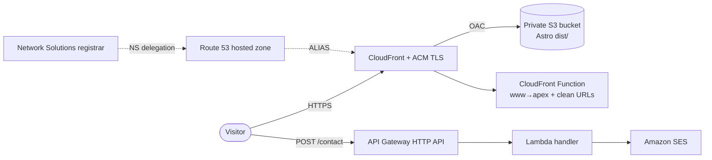

# AITeCXO Website

Marketing website for **AITeCXO** — AI innovation, implementation, and integration consulting for SMB and enterprise teams. Live at [aitecxo.com](https://aitecxo.com).

Built as a static [Astro](https://astro.build) site, hosted on AWS (S3 + CloudFront + Route 53), with a serverless contact form (API Gateway + Lambda + SES). All infrastructure is defined as code with the AWS CDK.

## Tech stack

- **Framework:** Astro 7 (static output — no server required)
- **Styling:** Tailwind CSS v4 (via `@tailwindcss/vite`)
- **Content:** Markdown content collections for case studies and insights
- **Hosting:** Amazon S3 (private) + CloudFront (OAC) + ACM + Route 53
- **Contact API:** Amazon API Gateway (HTTP API) + AWS Lambda + Amazon SES
- **IaC:** AWS CDK (TypeScript), run via `tsx`
- **CI/CD:** GitHub Actions with AWS OIDC (no stored credentials)

## Project structure

```
.
├── src/
│   ├── pages/         # Routes (home, services, about, work, insights, contact, pricing, faq)
│   ├── components/    # Header, Footer, Hero, ServiceCard, CTA, ContactForm, …
│   ├── layouts/       # BaseLayout (SEO head, header/footer shell)
│   ├── content/       # case-studies/*.md and insights/*.md
│   ├── styles/        # global.css (Tailwind + design tokens)
│   └── config.ts      # Site metadata, navigation, services
├── public/            # favicon, og image, robots.txt
├── infra/             # AWS CDK app (DnsStack, SiteStack, ContactApiStack)
└── .github/workflows/ # deploy.yml (CI/CD)
```

## Local development

Requires Node.js 20+.

```bash
npm install
npm run dev        # http://localhost:4321
```

Other scripts:

```bash
npm run build      # Build the static site to dist/
npm run preview    # Preview the production build locally
```

### Contact form

The contact form posts to the serverless endpoint defined by `PUBLIC_CONTACT_API_URL`. Copy `.env.example` to `.env` and set it to the `ContactApiUrl` output from the CDK deploy. Until it is set, the form gracefully falls back to a `mailto:` link.

## Deployment architecture

The site is fully static and served from S3 through CloudFront; the only dynamic piece is the serverless contact API. Everything is defined as code in [`infra/`](infra/) and deployed to **us-east-1** (required for CloudFront's ACM certificate).



Three CDK stacks, deployed in order:

- **`AitecxoDnsStack`** — the Route 53 public hosted zone. `aitecxo.com` is registered at **Network Solutions**, whose nameservers are delegated to this zone. Deployed first so ACM can validate via DNS.
- **`AitecxoSiteStack`** — a private S3 bucket (no public access) served by CloudFront via Origin Access Control, an ACM certificate covering the apex and `www`, apex/`www` ALIAS records, and a CloudFront Function that redirects `www` → apex and rewrites clean URLs (e.g. `/services` → `/services/index.html`). Missing paths return the site's `404.html`.
- **`AitecxoContactApiStack`** — an HTTP API → Node.js Lambda → SES. CORS is locked to `https://aitecxo.com`, a honeypot + server-side validation reject spam, and the stage is throttled.

### Current environment

- **AWS account / region:** `358254890860` / `us-east-1`
- **Hosted zone:** `Z04272101NWQH90TO3IKE`
- **CloudFront distribution:** `EPQ17AE6B3LLH` (`dbnrgfydwaex.cloudfront.net`)
- **Site bucket:** `aitecxositestack-sitebucket397a1860-h5wc1rljrytw`
- **Contact endpoint:** `https://v2lrzu3l73.execute-api.us-east-1.amazonaws.com/contact`

These values change if resources are recreated, so treat CloudFormation as the source of truth:

```bash
aws cloudformation describe-stacks --region us-east-1 \
  --stack-name AitecxoSiteStack --query "Stacks[0].Outputs" --output table
```

## Deploying changes

First-time setup (bootstrap, DNS delegation, SES) is in **[DEPLOY.md](DEPLOY.md)**. After that:

### Automated (recommended)

Once the GitHub Actions OIDC role is configured (DEPLOY.md §7), pushing to `main` runs [`.github/workflows/deploy.yml`](.github/workflows/deploy.yml): it deploys the CDK stacks, builds the site with the contact endpoint injected, syncs `dist/` to S3, and invalidates CloudFront.

```bash
git add -A && git commit -m "…" && git push origin main
```

### Manual

Requires valid credentials (`aws login`; sessions last up to 12h). From the repo root:

```bash
# 1. Deploy infra changes (safe to run even if nothing changed)
( cd infra && npm ci && npx cdk deploy --all --require-approval never --outputs-file cdk-outputs.json )

# 2. Read the live outputs
API=$(jq -r '.AitecxoContactApiStack.ContactApiUrl' infra/cdk-outputs.json)
BUCKET=$(jq -r '.AitecxoSiteStack.BucketName' infra/cdk-outputs.json)
DIST=$(jq -r '.AitecxoSiteStack.DistributionId' infra/cdk-outputs.json)

# 3. Build with the contact endpoint, publish, and invalidate
npm ci
PUBLIC_CONTACT_API_URL="$API" npm run build
aws s3 sync dist "s3://$BUCKET" --delete
aws cloudfront create-invalidation --distribution-id "$DIST" --paths "/*"
```

For **content-only** changes (no infra edits), skip step 1.

## Maintenance & operations

### Add a case study or insight

Drop a Markdown file into `src/content/case-studies/` or `src/content/insights/` using the frontmatter schema in `src/content.config.ts` (see the existing entries). Set `draft: true` to keep an entry out of the build. Then deploy.

### Update nav, services, or contact details

Edit `src/config.ts` — the single source of truth for site metadata, navigation, the service pillars, and the contact email.

### Contact form / SES

- The Lambda sends from `no-reply@aitecxo.com` to `hello@aitecxo.com` by default. Change recipients by redeploying with context, e.g. `cd infra && npx cdk deploy AitecxoContactApiStack -c contactToEmail=you@example.com`.
- Delivery requires a verified SES domain identity for `aitecxo.com`; while in the SES sandbox, both sender and recipient must fall under a verified identity (see DEPLOY.md §5).
- Tail Lambda logs: `aws logs tail /aws/lambda/<function-name> --follow --region us-east-1` (find the name under the ContactApiStack resources).

### Credentials

Local deploys use `aws login` (short-lived, auto-rotating, ≤12h). CI uses GitHub OIDC — no long-lived AWS keys are stored anywhere.

### Roll back

Revert the offending commit and redeploy (`git revert <sha>` then push, or run the manual steps above). Infrastructure rolls back via a `cdk deploy` of the previous definition.

### Tear down

```bash
( cd infra && npx cdk destroy --all )
```

The site bucket auto-empties on delete. Keep `AitecxoDnsStack` if you plan to redeploy, so you don't have to re-delegate nameservers at the registrar.
